# Relatório de Provisionamento de Recursos Computacionais

**Atividade 3 Deploy de aplicações em infraestrutura IaaS com OpenStack**  
**Identificação dos recursos nas evidências:** `grupo-2-ahv`  

## Grupo

- Arthur Gabriel Santos Albuquerque - 122110395
- Hildon Regis Navarro Neto - 122110322
- Victor Vili Xavier Luna - 122110387

## 1. Introdução

A atividade teve como objetivo provisionar uma máquina virtual, implantar as aplicações desenvolvidas na atividade anterior e disponibilizar seu acesso por meio de um `load balancer`.

O OpenStack foi utilizado por sua interface de linha de comando para consultar recursos e solicitar a criação e associação de componentes da infraestrutura.


## 2. Acesso e exploração do ambiente OpenStack

### 2.1 Preparação da CLI e autenticação

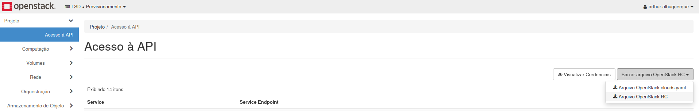

*Figura 1 — Página de acesso à API no contexto LSD e projeto Provisionamento, com opção de download do OpenRC.*

O arquivo OpenRC fornece a configuração necessária para autenticar a CLI. O carregamento e a verificação do token podem ser realizados com:

```bash
source [ARQUIVO_OPENRC]
openstack token issue
```

### 2.2 Consulta dos recursos disponíveis

A exploração começou pela consulta dos flavors. A consulta de flavors é feita por `openstack flavor list`. A figura apresenta a tabela de resultados.

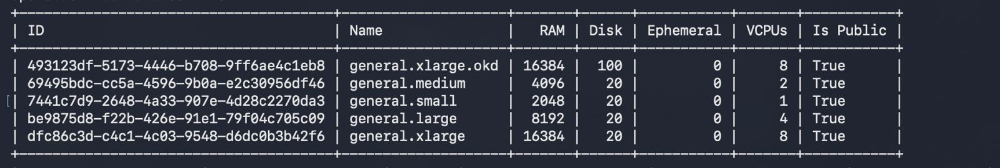

*Figura 2 — Flavors disponíveis, incluindo general.small com 1 vCPU e 2048 MiB de RAM.*

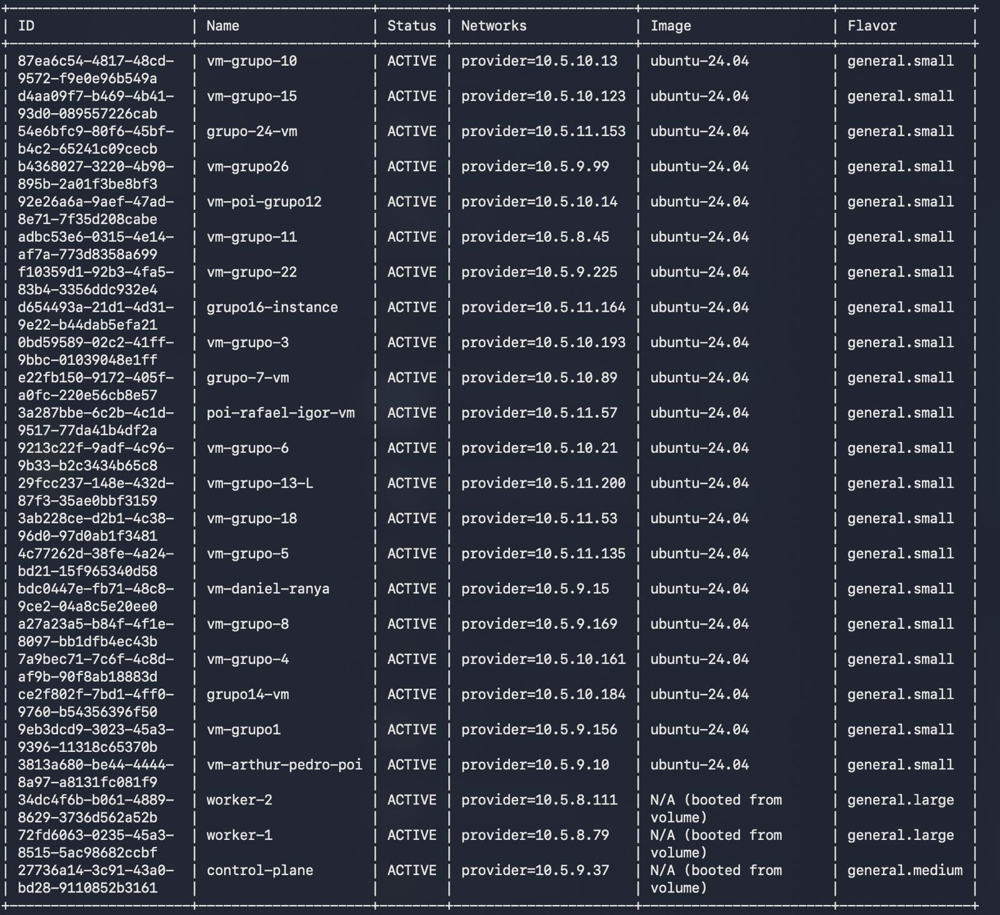

*Figura 3 — Instâncias existentes no projeto antes da criação da VM desta execução.*

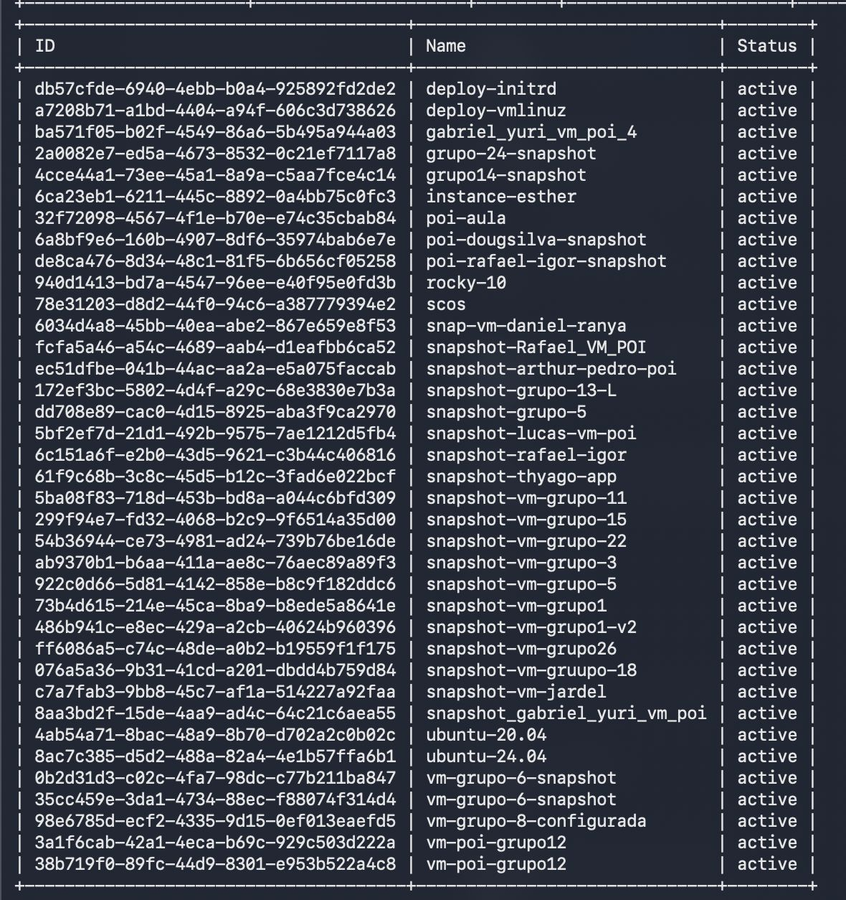

*Figura 4 — Imagens disponíveis, incluindo ubuntu-24.04 e imagens de snapshots preexistentes.*

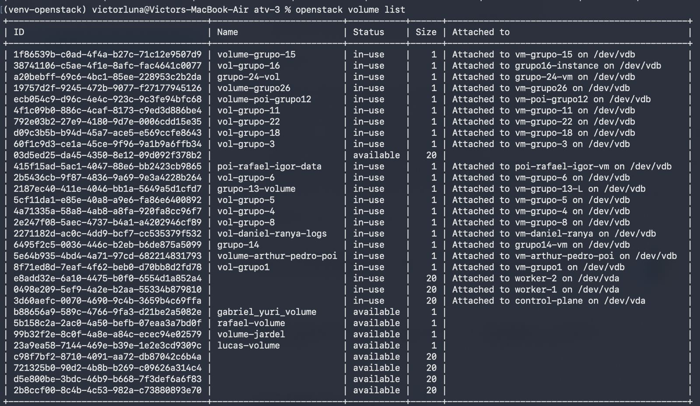

*Figura 5 — Listagem inicial de volumes e suas associações a instâncias.*

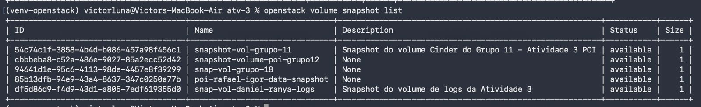

*Figura 6 — Snapshots de volumes Cinder existentes no ambiente.*

Por fim, `openstack loadbalancer list` identificou `poi-atividades`, com VIP `10.5.8.242`, provider `amphora`, `provisioning_status=ACTIVE` e `operating_status=ONLINE`. Esses estados descrevem o balanceador no momento da consulta

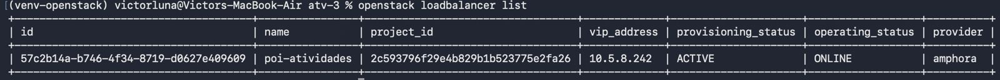

*Figura 7 — Balanceador compartilhado poi-atividades em ACTIVE e ONLINE.*

## 3. Provisionamento da máquina virtual

### 3.1 Criação e cadastro do par de chaves

O par de chaves foi gerado na máquina local com Ed25519, utilizando o caminho `$HOME/.ssh/grupo-2-ahv`. O comando registrado é:

```bash
ssh-keygen -t ed25519 -f "$HOME/.ssh/grupo-2-ahv" -N ""
```

A opção `-f` define onde os arquivos serão gravados e `-N ""` indica ausência de passphrase.

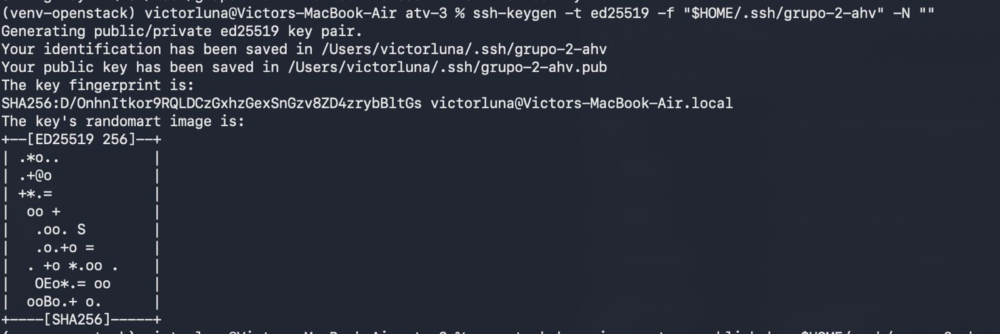

*Figura 8 — Geração local do par de chaves SSH Ed25519.*

Em seguida, a chave pública foi importada com o nome `grupo-2-ahv-key`:

```bash
openstack keypair create --public-key "$HOME/.ssh/grupo-2-ahv.pub" grupo-2-ahv-key
openstack keypair list
```

A resposta da criação e a listagem exibem a mesma chave e fingerprint, comprovando seu cadastro. Não há comparação adicional do fingerprint local em MD5, mas o comando de importação identifica o arquivo público gerado na etapa anterior.

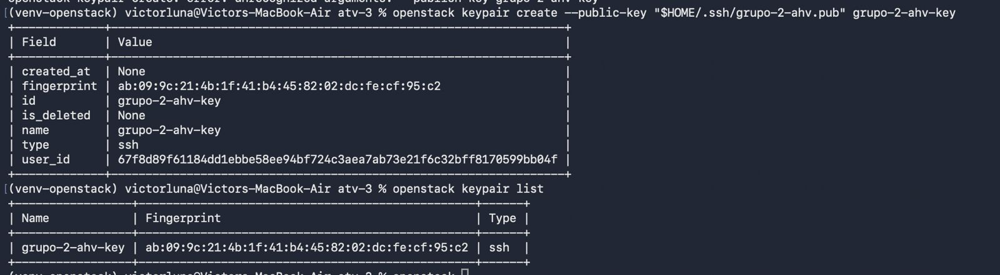

*Figura 9 — Cadastro e listagem da chave grupo-2-ahv-key no OpenStack.*

### 3.2 Grupo de segurança

Foi criado o security group `grupo-2-ahv-sg`, com descrição de acesso SSH. A resposta inicial apresenta as regras de saída associadas ao grupo. A criação isolada não libera automaticamente o tráfego de entrada necessário ao SSH.

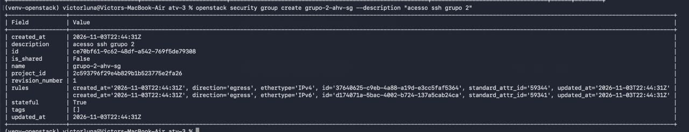

*Figura 10 — Criação do security group grupo-2-ahv-sg.*

Para permitir conexões SSH à VM, foi acrescentada uma regra de entrada TCP na porta 22:

```bash
openstack security group rule create --ingress --protocol tcp --dst-port 22 --remote-ip 0.0.0.0/0 grupo-2-ahv-sg
```

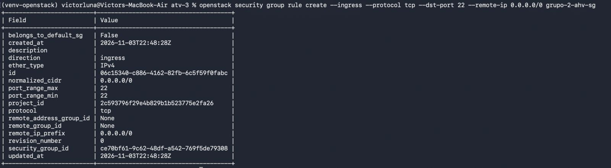

*Figura 11 — Regra de entrada TCP/22 para acesso SSH à VM.*

Também foi criada uma regra de entrada ICMP para permitir testes desse protocolo.

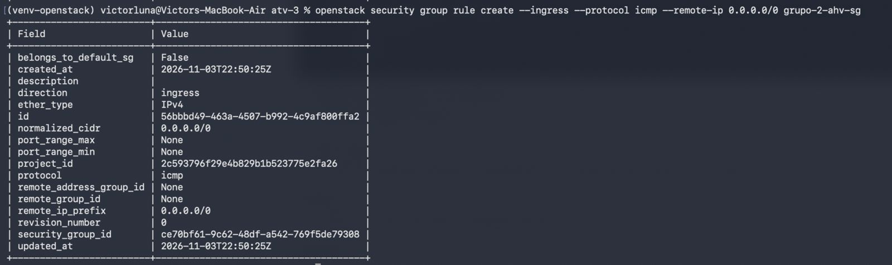

*Figura 12 — Regra de entrada ICMP no grupo de segurança.*

### 3.3 Criação e verificação da instância

A instância foi solicitada com o flavor e a imagem exigidos, a chave recém-cadastrada e o security group configurado:

```bash
openstack server create \
  --flavor general.small \
  --image ubuntu-24.04 \
  --key-name grupo-2-ahv-key \
  --security-group grupo-2-ahv-sg \
  --network provider \
  --wait \
  grupo-2-ahv-vm
```

Os parâmetros `--flavor` e `--image` selecionam os recursos e o sistema operacional. `--key-name` associa a chave pública à instância, `--security-group` aplica as regras de rede e `--network provider` conecta a VM à rede utilizada no projeto. A opção `--wait` faz o cliente aguardar a conclusão do provisionamento.

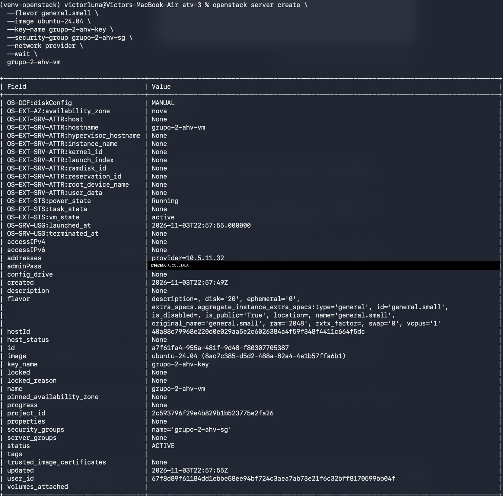

*Figura 13 — VM provisionada com os parâmetros exigidos e estado ACTIVE; credencial ocultada.*

## 4. Configuração do acesso SSH

### 4.1 Identificação do ponto de entrada

O balanceador `poi-atividades` é compartilhado. Antes da criação do listener do grupo, foi executado `openstack loadbalancer listener list --loadbalancer poi-atividades`, permitindo consultar as portas já utilizadas.

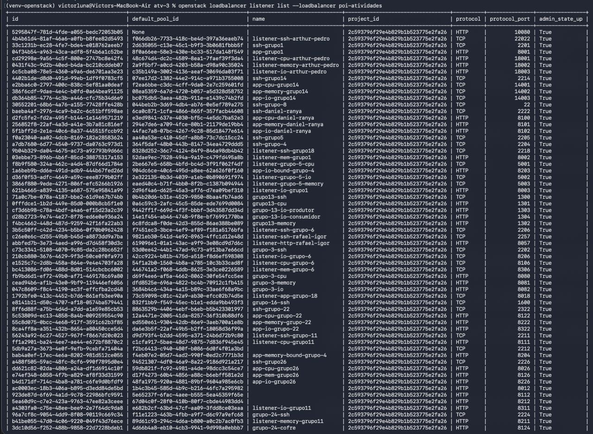

*Figura 14 — Listeners preexistentes no balanceador compartilhado.*

O comando `openstack floating ip list` mostrou o endereço público `150.165.85.77` associado ao IP fixo `10.5.8.242`, o mesmo VIP observado na listagem do balanceador.

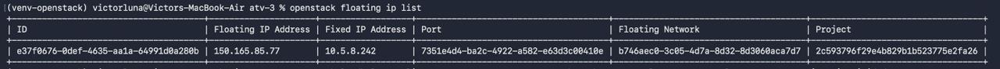

*Figura 15 — Floating IP 150.165.85.77 associado ao VIP 10.5.8.242.*

### 4.2 Listener, pool e member

Foi criado o listener `grupo-2-ahv-ssh` no `poi-atividades`, utilizando TCP e porta 10001. TCP é adequado ao encaminhamento de SSH, pois o balanceador não precisa interpretar um protocolo HTTP.

```bash
openstack loadbalancer listener create --name grupo-2-ahv-ssh --protocol TCP --protocol-port 10001 --wait poi-atividades
```

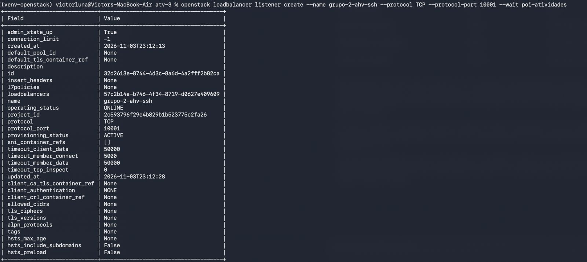

*Figura 16 — Listener SSH criado na porta TCP/10001 de poi-atividades.*

O pool `grupo-2-ahv-ssh-pool` foi criado com protocolo TCP, associado ao listener, e algoritmo `ROUND_ROBIN`. Com uma única VM, todas as conexões elegíveis têm o mesmo destino.

```bash
openstack loadbalancer pool create \
  --name grupo-2-ahv-ssh-pool \
  --listener grupo-2-ahv-ssh \
  --protocol TCP \
  --lb-algorithm ROUND_ROBIN \
  --wait
```

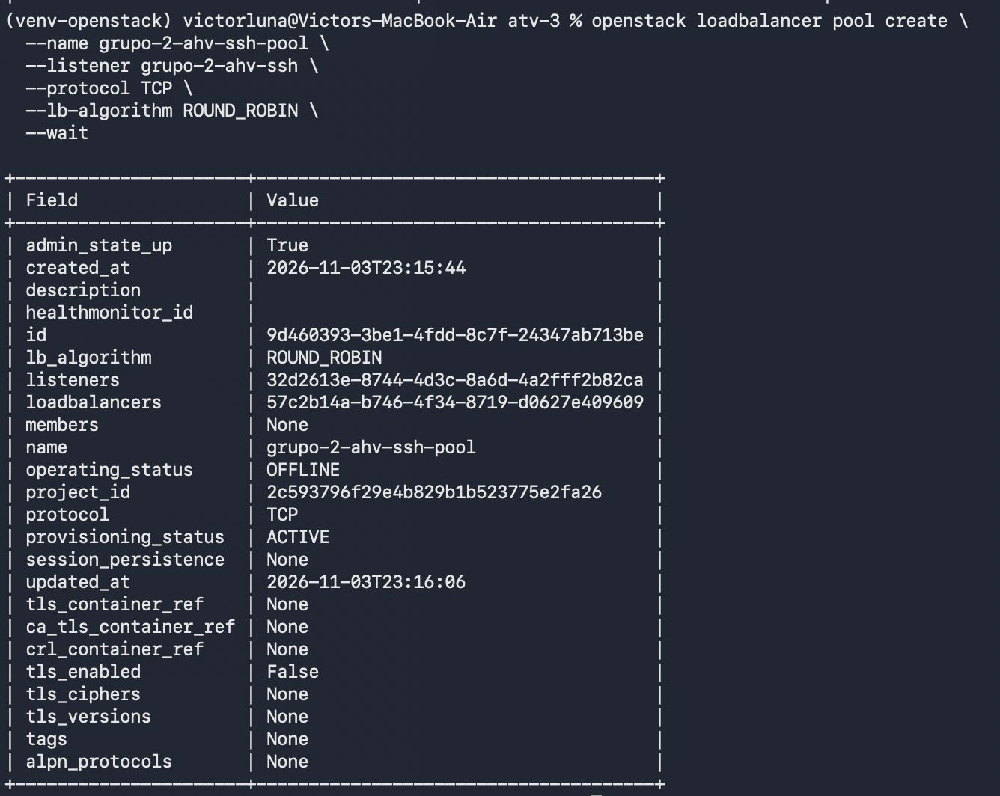

*Figura 17 — Pool TCP associado ao listener SSH, ainda sem members nesta etapa.*

Por último, foi cadastrado o member `grupo-2-ahv-ssh-member`, apontando para o IP da VM, porta 22 e subnet `provider-sub`:

```bash
openstack loadbalancer member create \
  --name grupo-2-ahv-ssh-member \
  --address 10.5.11.32 \
  --protocol-port 22 \
  --subnet-id provider-sub \
  --wait \
  grupo-2-ahv-ssh-pool
```

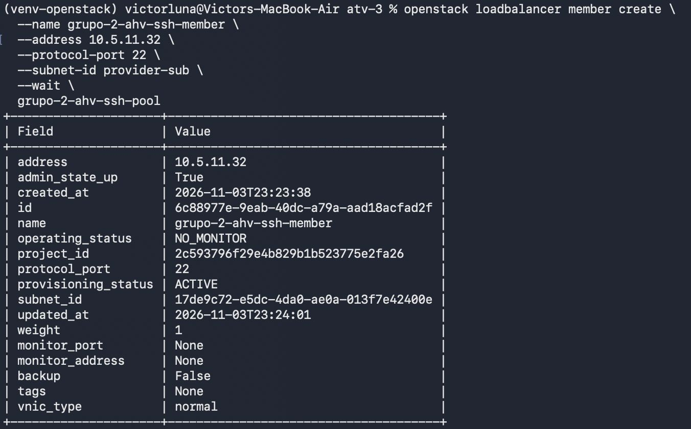

*Figura 18 — Member configurado para encaminhar SSH à VM em 10.5.11.32:22.*

A cadeia configurada é `150.165.85.77:10001` → VIP do `poi-atividades` → listener TCP → pool SSH → `10.5.11.32:22`.

## 5. Deploy das aplicações

### 5.1 Aplicações identificadas

O repositório utilizado é `https://github.com/POI-2026-2-grupo15/atividade-2`. O código local contém três APIs Python com FastAPI, executáveis com Uvicorn:

| Aplicação | Finalidade | Rotas relevantes no código | Porta prevista na VM |
|---|---|---|---|
| CPU-bound | Processamento de hashes e benchmark de CPU | `GET /health`, `POST /hash`, `POST /verify`, `POST /benchmark` | 8000 |
| IO-bound | Escrita, leitura e verificação de arquivos temporários | `GET /health`, `POST /io` | 8001 |
| Memory-bound | Consolidação de registros recebidos em arquivos CSV | `POST /memory-test` | 8002 |

A API de memória não define `/health`; por isso, `/docs` pode ser utilizado para uma checagem HTTP de disponibilidade. A documentação do FastAPI não substitui um teste funcional da consolidação de arquivos. As portas da tabela correspondem aos endereços de inicialização registrados nos logs de Uvicorn. Não há captura de `ss`, mas o teste externo e o log apresentados na seção 7.5 confirmam atendimento de uma requisição `/health` por CPU-bound.

### 5.2 Obtenção do código

A cópia do repositório foi realizada após a montagem do volume. A primeira tentativa usou `/atividade-2` como destino e falhou por falta de permissão na raiz do sistema. Na mesma captura, o destino foi corrigido para `$HOME/atividade-2`, e o clone terminou com recebimento e resolução dos objetos concluídos:

```bash
git clone https://github.com/POI-2026-2-grupo15/atividade-2.git "$HOME/atividade-2"
```

O diretório resultante é `/home/ubuntu/atividade-2`. O erro inicial foi resolvido e não impede o prosseguimento. A captura não registra o hash do commit efetivamente obtido na VM.

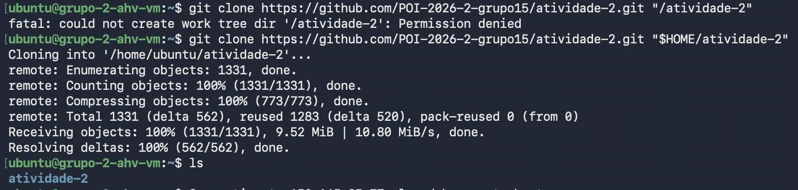

*Figura 19 — Clone do repositório concluído após correção do diretório de destino.*

### 5.3 Ambiente virtual e dependências

Dentro do repositório, foram registrados a criação e a ativação de um ambiente virtual, seguidas da instalação dos requisitos das três aplicações:

```bash
python3 -m venv .venv
source .venv/bin/activate
pip install -r cpu-bound/requirements.txt -r io-bound/requirements.txt -r memory-bound/requirements.txt
```

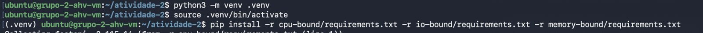

*Figura 20 — Criação do ambiente virtual e início da instalação das dependências.*

### 5.4 Configuração dos serviços e inicialização

A figura registra comandos `sudo tee` para gravar as unidades systemd `poi-cpu-bound.service`, `poi-io-bound.service` e `poi-memory-bound.service`. Cada unidade define o diretório de trabalho da aplicação, o usuário de execução e o Python do ambiente virtual. 

O `ExecStart` de cada unidade executa Uvicorn com `app.main:app`, endereço `0.0.0.0` e portas 8000, 8001 e 8002, correspondentes as 3 aplicações. `Restart=on-failure` solicita reinício após falha; `WantedBy=multi-user.target` permite habilitação para o boot. As unidades também incluem o redirecionamento das saídas para os arquivos de log no volume.

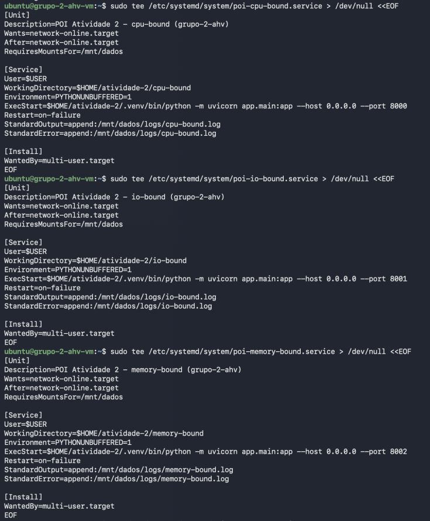

*Figura 21 — Comandos de criação das três unidades systemd com Uvicorn e logs em /mnt/dados/logs.*

Nessa segunda captura, apresentada na seção 6.3, mostra os três logs com `Application startup complete` e `Uvicorn running` nos endereços `0.0.0.0:8000`, `0.0.0.0:8001` e `0.0.0.0:8002`. Isso comprova que cada processo chegou à inicialização.

## 6. Configuração do armazenamento

Embora descrito após o deploy por organização por temas, o volume foi criado e montado antes do clone e da instalação das aplicações. Essa ordem permitiu preparar o destino dos logs antes de iniciar os serviços.

### 6.1 Criação e associação do volume

Foi solicitado e criado um volume chamado `grupo-2-ahv-vol`, com tamanho 1:

```bash
openstack volume create --size 1 --description "volume grupo-2-ahv" grupo-2-ahv-vol
```

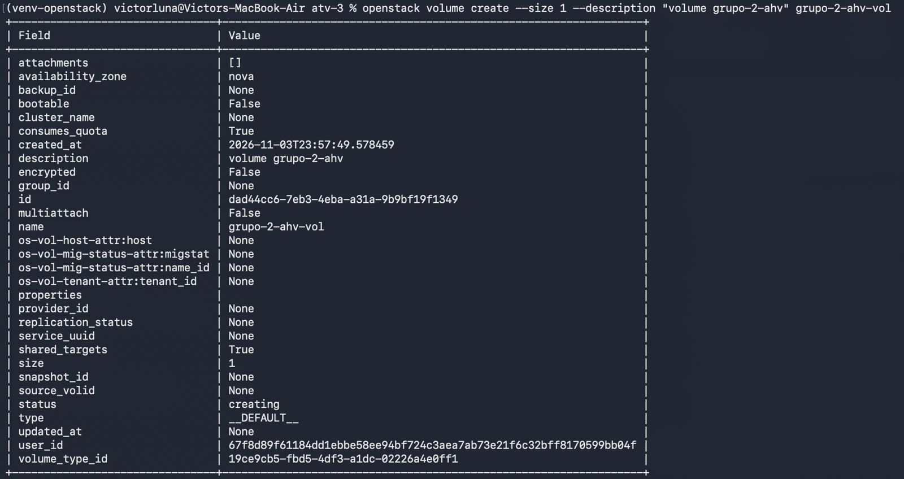

*Figura 22 — Criação do volume grupo-2-ahv-vol com tamanho solicitado de 1 GB.*

O volume foi associado à instância pelo comando:

```bash
openstack server add volume grupo-2-ahv-vm grupo-2-ahv-vol
```

A saída relaciona o mesmo volume ao ID `a7f61fa4-955a-481f-9d48-f8037705387`, correspondente à VM criada, e informa `/dev/vdb` como dispositivo. 

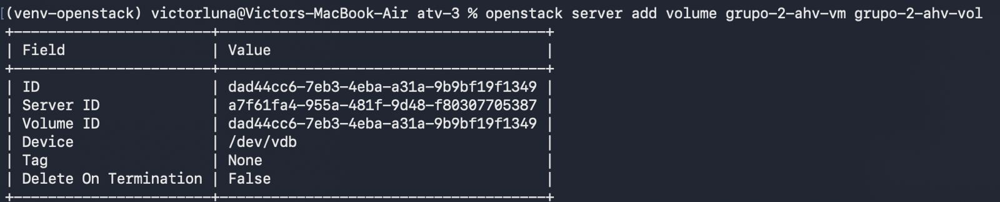

*Figura 23 — Associação do volume adicional à VM correta, com dispositivo informado como /dev/vdb.*

### 6.2 Formatação e montagem

Na sessão `ubuntu@grupo-2-ahv-vm`, foi executado:

```bash
sudo mkfs.ext4 /dev/vdb
sudo mkdir -p /mnt/dados
```

O `mkfs.ext4` concluiu a criação do sistema de arquivos, incluindo journal e superblocos, com UUID `81e3bf88-6c2d-4d66-af1c-a5b061a7556b`. Foram apresentados 262144 blocos de 4 KiB, equivalentes a 1 GiB de capacidade bruta. 

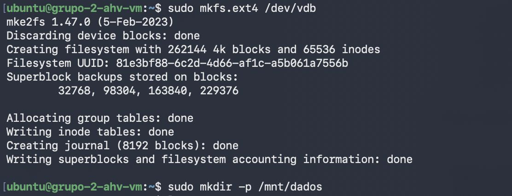

*Figura 24 — Formatação ext4 de /dev/vdb concluída e criação do ponto de montagem.*

A captura seguinte apresenta `sudo mount -a` e `df -h /mnt/dados`. O resultado associa `/dev/vdb` a `/mnt/dados`, com 974M de tamanho, 24K usados e 907M disponíveis. O tamanho útil exibido após a formatação é devido a capacidade bruta de 1 GiB.

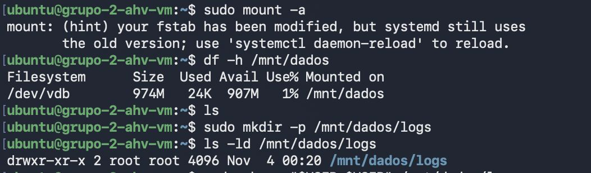

*Figura 25 — Volume montado em /mnt/dados e criação do diretório de logs.*

### 6.3 Utilização pelas aplicações

O disco original da VM hospeda o sistema operacional e, conforme o clone observado, o repositório em `/home/ubuntu/atividade-2`. O volume adicional é um recurso Cinder separado, anexado como `/dev/vdb` e montado em `/mnt/dados`. Arquivos gravados nesse ponto de montagem, enquanto a montagem está ativa, utilizam o volume adicional.

A configuração dos serviços apresentada na seção 5.4 direciona `StandardOutput=append:` e `StandardError=append:` para `/mnt/dados/logs/cpu-bound.log`, `/mnt/dados/logs/io-bound.log` e `/mnt/dados/logs/memory-bound.log`. As três unidades incluem `RequiresMountsFor=/mnt/dados`, para depender da montagem desse caminho antes de iniciar.

A saída de `ls -l /mnt/dados/logs/` lista os três arquivos com 195 bytes cada. O comando `tail -n 5` exibe a inicialização concluída de cada aplicação, incluindo os processos 9801, 9802 e 9803 e os endereços de escuta nas portas 8000–8002. 

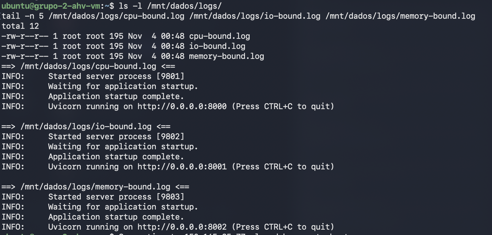

*Figura 26 — Arquivos de log das três APIs com inicialização concluída e endereços Uvicorn nas portas 8000–8002.*

A captura acima apresenta a inicialização. 

## 7. Acesso às aplicações pelo balanceador

### 7.1 Encaminhamento previsto

A publicação das três APIs utiliza uma cadeia de encaminhamento HTTP por aplicação no lead balancer previsto na atividade. As capturas comprovam a criação do listener e do pool de CPU-bound e uma resposta HTTP por seu endereço externo. A tabela reúne também os destinos e os recursos previstos para as demais etapas.

| Aplicação | Listener previsto no LB | Pool previsto | Destino previsto | Rota de monitor proposta |
|---|---|---|---|---|
| CPU-bound | `grupo-2-ahv-cpu`, HTTP/10002 | `grupo-2-ahv-cpu-pool` | `10.5.11.32:8000` | `/health` |
| IO-bound | `grupo-2-ahv-io`, HTTP/10003 | `grupo-2-ahv-io-pool` | `10.5.11.32:8001` | `/health` |
| Memory-bound | `grupo-2-ahv-memory`, HTTP/10004 | `grupo-2-ahv-memory-pool` | `10.5.11.32:8002` | `/docs` |

A configuração seguiria o encadeamento listener → pool → member. O listener receberia HTTP na porta externa; o pool definiria o conjunto de destinos e o algoritmo `ROUND_ROBIN`; o member apontaria para a VM na porta específica da aplicação.

### 7.2 Liberação das portas das aplicações

A figura registra a criação da regra de entrada para as portas TCP 8000–8002 no security group da VM:

```bash
openstack security group rule create --ingress --protocol tcp --dst-port 8000:8002 --remote-ip 0.0.0.0/0 grupo-2-ahv-sg
```

O retorno confirma `direction=ingress`, `protocol=tcp`, `port_range_min=8000` e `port_range_max=8002`, no mesmo grupo de segurança associado à VM. A regra permite alcançar as três portas a partir de qualquer origem com acesso de rede à instância.

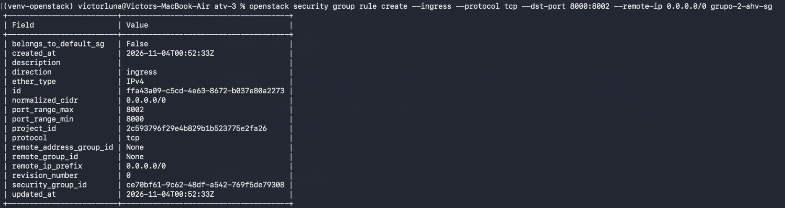

*Figura 27 — Criação da regra de entrada TCP/8000–8002 no security group da VM.*

A criação do listener de CPU-bound na porta 10002 está documentada na próxima seção. Para as demais inclusões no LB compartilhado, deve-se verificar a disponibilidade das portas externas 10003–10004, preservando listeners e pools dos outros grupos.

### 7.3 Criação do listener e do pool HTTP da aplicação CPU-bound

A figura mostra a criação do listener `grupo-2-ahv-cpu`, com protocolo HTTP e porta externa 10002. O comando utiliza o ID `57c2b14a-b746-4f34-8719-d0627e409609`, correspondente ao balanceador `poi-atividades` identificado na exploração inicial:

```bash
openstack loadbalancer listener create --name grupo-2-ahv-cpu --protocol HTTP --protocol-port 10002 --wait 57c2b14a-b746-4f34-8719-d0627e409609
```

A resposta apresenta `provisioning_status=ACTIVE`, `operating_status=ONLINE` e ID de listener `b636b044-146d-47ae-b98c-01d019602b22`. Nesse momento, `default_pool_id=None`, pois o conjunto de destinos ainda não havia sido associado. 

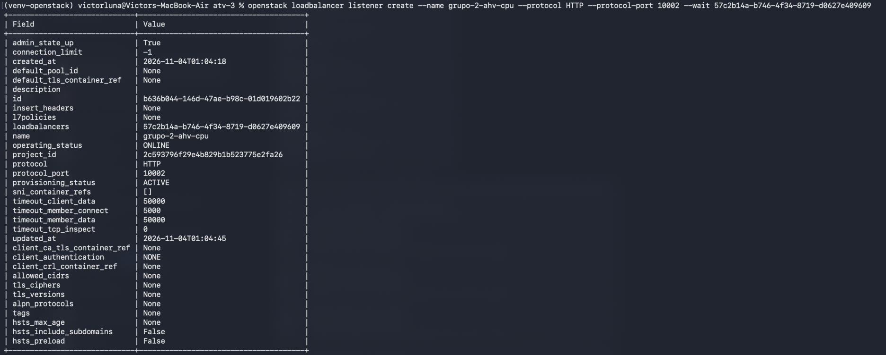

*Figura 28 — Listener HTTP de CPU-bound na porta 10002*

Na sequência, foi criado o pool `grupo-2-ahv-cpu-pool`, utilizando HTTP, algoritmo `ROUND_ROBIN` e associação ao listener recém-criado. A linha de comando na captura contém uma repetição visual de parte do prompt; os campos retornados permitem identificar o recurso e sua associação. O comando correspondente, organizado em uma única linha, é:

```bash
openstack loadbalancer pool create --name grupo-2-ahv-cpu-pool --listener grupo-2-ahv-cpu --protocol HTTP --lb-algorithm ROUND_ROBIN --wait
```

O resultado identifica o mesmo listener e o mesmo balanceador, com `provisioning_status=ACTIVE` e `operating_status=ONLINE`. 

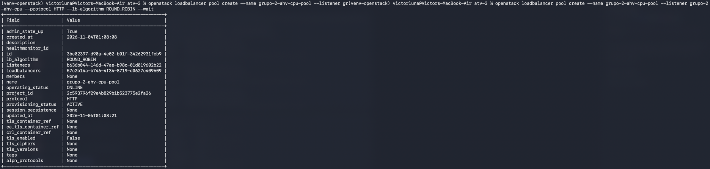

*Figura 29 — Pool HTTP de CPU-bound associado ao listener*

A Figura 30 apresenta uma visão geral da mesma saída de criação do pool. A Figura 29 oferece maior resolução para leitura dos comandos e campos.

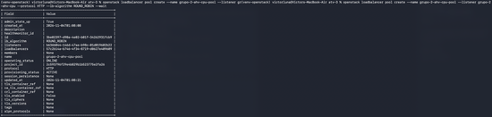

*Figura 30 — Visão reduzida da criação do pool; conteúdo sobreposto ao da Figura 29.*

### 7.4 Repetição do procedimento para IO-bound e Memory-bound

O processo de configuração se repete para os outros dois tipos de aplicação, alterando os nomes dos recursos e as portas. Para IO-bound, a configuração correspondente utiliza listener HTTP na porta externa 10003 e member na porta 8001 da VM. Para Memory-bound, utiliza listener HTTP na porta externa 10004 e member na porta 8002. Em ambos os casos, o pool utiliza HTTP e `ROUND_ROBIN`, com destino na mesma VM `10.5.11.32`, sem criação de novas instâncias.

### 7.5 Teste externo de CPU-bound e registro da requisição

No terminal local, foi executado o teste pelo floating IP do balanceador e pela porta do listener de CPU-bound:

```bash
curl -fsS http://150.165.85.77:10002/health
```

O retorno foi `{"status":"ok"}`. A opção `-f` faz o curl indicar falha em respostas HTTP de erro; `-sS` reduz a saída de progresso e mantém mensagens de erro. A resposta observada demonstra que o caminho externo pela porta 10002 estava atendendo a rota de saúde da aplicação naquele momento. Esse teste comprova uma conexão com resposta da API.


*Figura 31 — Resposta de CPU-bound ao teste de /health pelo balanceador.*

Na VM, foi executado `tail -n 5` sobre os caminhos dos três logs. O recorte fornecido mostra apenas o bloco de `cpu-bound.log`, com a inicialização do processo 9801 em `0.0.0.0:8000` e uma requisição `GET /health HTTP/1.1` com resposta `200 OK`, originada de `10.5.11.10:10917`.

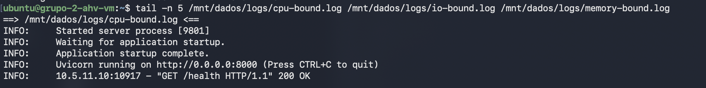

*Figura 32 — Requisição de saúde registrada em /mnt/dados/logs/cpu-bound.log.*

A resposta externa e a linha de log são evidências compatíveis do encaminhamento até CPU-bound. 

## 8. Criação do snapshot

Após a configuração dos serviços e da publicação HTTP documentada, foi executado o comando de snapshot da VM:

```bash
openstack server image create --name grupo-2-ahv-vm-snapshot --wait grupo-2-ahv-vm
```

A opção `--name` identifica a imagem resultante e `--wait` faz a CLI aguardar o término da operação. A saída apresenta `grupo-2-ahv-vm-snapshot` com ID `26f1a977-18c3-4377-8c11-3aaec8587e00`, formato `qcow2`, visibilidade `private` e `status=active`, comprovando a conclusão da criação.

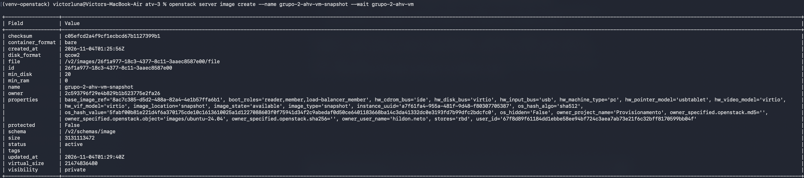

*Figura 33 — Snapshot concluído em active, associado à VM correta e ao projeto Provisionamento.*

A propriedade `instance_uuid=a7f61fa4-955a-481f-9d48-f8037705387` corresponde ao ID da VM provisionada na seção 3. `base_image_ref=8ac7c385-d5d2-488a-82a4-4e1b57ffa6b1` corresponde à imagem Ubuntu 24.04 utilizada. A propriedade `image_type=snapshot` identifica o tipo de imagem, e `owner_project_name=Provisionamento`, junto do campo `owner`, confirma o projeto associado aos recursos.

O snapshot apresenta `created_at=2026-11-04T01:25:56Z` e `updated_at=2026-11-04T01:29:40Z`, equivalentes a 22h25min56s e 22h29min40s de 3 de novembro em UTC−3. Esses horários são posteriores às inicializações registradas nos arquivos de log e à criação do listener e do pool HTTP, sustentando a ordem de criação após essas configurações. O teste de curl não contém horário visível; sua posição exata em relação ao início do snapshot não pode ser confirmada apenas pelas capturas.

Nesta instância, criada a partir de uma imagem com disco de sistema, o snapshot registra o disco raiz, onde foram instalados o código, o ambiente Python e as configurações dos serviços. Ele deve ser distinguido do volume Cinder adicional: não se deve afirmar que os arquivos de `/dev/vdb`, incluindo os logs em `/mnt/dados`, estão automaticamente incluídos nessa imagem. 
